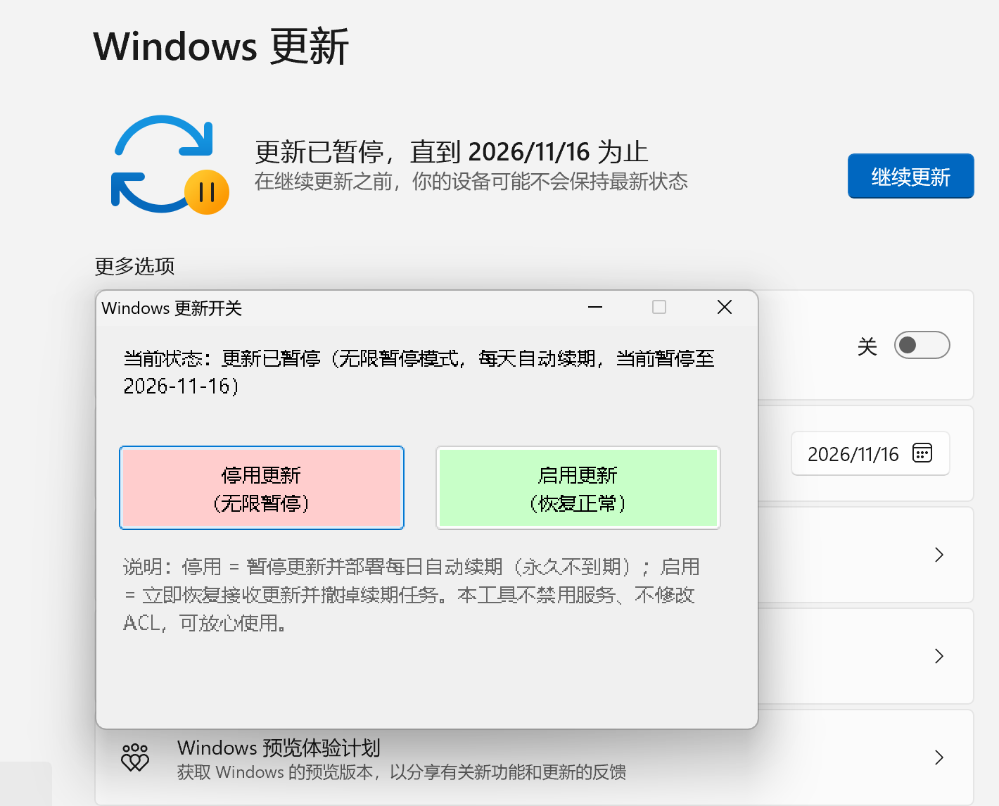

# UpdateToggle - Windows 更新开关

[English](#english) | [中文](#中文说明)

A lightweight Windows utility to toggle Windows Update with infinite pause support. No service disabling, no registry ACL locks, no side effects.

## Features

- **One-click pause**: Pauses Windows Update for 34 days (official mechanism)
- **Infinite pause mode**: Automatically renews the pause daily via scheduled tasks
- **One-click resume**: Restores normal update behavior and removes scheduled tasks
- **Status display**: Shows current pause status and warns about disabled update services
- **No side effects**: Uses official Windows Update pause mechanism, doesn't disable services or modify ACLs
- **Standalone**: Single 10KB executable, no dependencies, no installation required

## Screenshot



## Usage

1. Download `UpdateToggle.exe` from [Releases](https://github.com/skynacu/UpdateToggle/releases)
2. Double-click to run (UAC prompt will appear)
3. Click **"停用更新（无限暂停）"** to pause updates with auto-renewal
4. Click **"启用更新（恢复正常）"** to resume updates

**Note**: After enabling infinite pause, do not move or delete the exe file (scheduled tasks point to its path).

## Build from Source

### Prerequisites

- Windows 10/11
- .NET Framework 4.8 Developer Pack (for dotnet CLI build) OR
- Visual Studio 2019+ (for MSBuild build) OR
- No additional tools needed (for csc.exe fallback build)

### Method 1: Using dotnet CLI (Recommended)

```bash
dotnet build -c Release
```

The executable will be in `bin/Release/net48/`.

### Method 2: Using Visual Studio

1. Open `UpdateToggle.csproj` in Visual Studio
2. Build → Build Solution (Ctrl+Shift+B)

### Method 3: Using csc.exe (Fallback, no extra tools)

```cmd
build.cmd
```

This uses the system's built-in C# compiler. The executable will be generated in the project root.

## How It Works

- **Pause**: Writes pause timestamps to `HKLM\SOFTWARE\Microsoft\WindowsUpdate\UX\Settings` (same as Settings UI)
- **Auto-renewal**: Creates two SYSTEM scheduled tasks (`WindowsUpdatePauseRenew` daily at 12:00, `WindowsUpdatePauseRenewBoot` at startup) that call `UpdateToggle.exe --renew`
- **Renewal logic**: The `--renew` mode checks for an "infinite pause" flag before renewing, so manually resuming updates via Settings UI won't trigger unexpected re-pause
- **Resume**: Removes pause timestamps, flag key, and scheduled tasks

## Comparison with Other Tools

| Tool | Method | Side Effects |
|------|--------|--------------|
| **UpdateToggle** | Official pause mechanism + scheduled tasks | None |
| Windows Update Blocker | Disables services + ACL locks | High CPU, service conflicts |
| Wu10Man | Disables services + tasks | Moderate |
| O&O ShutUp10++ | Policy changes | Low |

## Disclaimer

This tool is provided as-is without warranty. It uses official Windows Update pause mechanisms but is not affiliated with Microsoft. Use at your own risk.

## License

MIT License - see [LICENSE](LICENSE) file for details.

---

## 中文说明

**UpdateToggle** 是一个轻量级的 Windows 更新管理工具，支持无限暂停功能。不禁用服务、不修改 ACL、无副作用。

### 功能特点

- **一键暂停**：暂停 Windows 更新 34 天（官方机制）
- **无限暂停模式**：通过计划任务每天自动续期，永久不到期
- **一键恢复**：恢复正常更新并移除计划任务
- **状态显示**：显示当前暂停状态，检测被禁用的更新服务
- **无副作用**：使用官方暂停机制，不禁用服务、不加 ACL 锁
- **独立运行**：单文件 10KB，无依赖，无需安装

### 使用方法

1. 从 [Releases](https://github.com/skynacu/UpdateToggle/releases) 下载 `UpdateToggle.exe`
2. 双击运行（会弹出 UAC 授权）
3. 点击 **"停用更新（无限暂停）"** 开启自动续期暂停
4. 点击 **"启用更新（恢复正常）"** 恢复更新

**注意**：开启无限暂停后，不要移动或删除 exe 文件（计划任务指向其路径）。

### 工作原理

- **暂停**：写入 `HKLM\SOFTWARE\Microsoft\WindowsUpdate\UX\Settings` 暂停时间戳（与设置界面等效）
- **自动续期**：创建两个 SYSTEM 计划任务（每天 12:00、开机时），调用 `UpdateToggle.exe --renew`
- **续期逻辑**：`--renew` 模式先检查"无限暂停"标记，用户在设置界面手动恢复更新后不会偷偷重停
- **恢复**：删除暂停时间戳、标记键和计划任务

### 与其他工具对比

| 工具 | 实现方式 | 副作用 |
|------|----------|--------|
| **UpdateToggle** | 官方暂停机制 + 计划任务 | 无 |
| Windows Update Blocker | 禁用服务 + ACL 锁 | 高 CPU、服务冲突 |
| Wu10Man | 禁用服务 + 任务 | 中等 |
| O&O ShutUp10++ | 策略修改 | 低 |

### 免责声明

本工具按"原样"提供，不提供任何保修。使用官方 Windows 更新暂停机制，但与微软无关。使用风险自负。

### 许可证

MIT 许可证 - 详见 [LICENSE](LICENSE) 文件。
